<picture>
  <source media="(prefers-color-scheme: dark)" srcset="./dark.svg">
  <source media="(prefers-color-scheme: light)" srcset="./light.svg">
  
</picture>

## About

Backend engineer working in Python and Django. I build REST APIs, model relational data, and automate work with background jobs and scripts.

## Focus

- REST API design with Django and Django REST Framework
- Relational data modeling and querying in PostgreSQL
- Background processing with Celery and Redis
- Python automation that connects internal tools

## Selected work

| Work | What it is |
| --- | --- |
| **Automations** | Python scripts that integrate internal tools to remove manual steps |
| **Health dashboard** | Run history, owners, schedules, logs and errors for a team's automations |
| **ConvoBuzz** | Real-time chat built with Django Channels and WebSockets |

## Stack

| Area | Tools |
| --- | --- |
| Language | Python |
| Backend | Django, Django REST Framework, Celery |
| Data | PostgreSQL, MongoDB, Redis |
| Tooling | Docker, Git |

## Connect

- GitHub: [kanhaya-kataruka](https://github.com/kanhaya-kataruka)
- LinkedIn: [kanhaya-kataruka](https://www.linkedin.com/in/kanhaya-kataruka/)
- Portfolio: [kanhaya.dev](https://kanhaya.dev)
